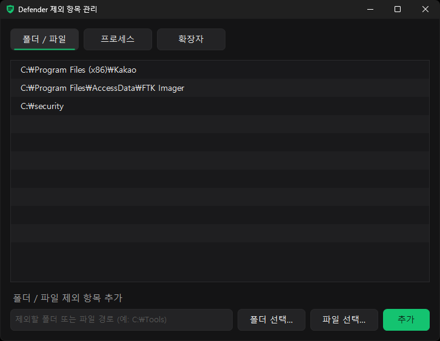

# Defender 제외 항목 관리


- WinForms
- 폴더, 파일 드래그 앤 드롭
- 단축키 `Del`, `Ctrl+C`, `F5`, 우클릭 메뉴
- 항목 더블클릭시 탐색기에서 열기

## 제외 종류

| 종류 | 기준 | 적용 범위 |
| --- | --- | --- |
| 폴더 / 파일 | 파일이 **어디에 있는지** | 예약, 수동, 실시간 검사 모두 |
| 프로세스 | 파일을 **누가 다루는지** | 실시간 검사만 |
| 확장자 | 파일의 확장자 | 예약, 수동, 실시간 검사 모두 |

VMware를 예로 들면 다음과 같음

- 설치 폴더 `C:\Program Files (x86)\VMware`를 **폴더 제외** : 그 폴더 안의 파일만 빠지고, VMware가 열고 쓰는 VM 디스크(`.vmdk`)처럼 다른 위치의 파일은 계속 검사함
- `vmware-vmx.exe`를 **프로세스 제외** : VMware가 다루는 `.vmdk` 같은 파일은 위치와 상관없이 실시간 검사에서 빠짐. `vmware-vmx.exe` 파일 자체는 계속 검사함

위치가 정해진 파일은 폴더 제외로, 특정 프로그램이 여러 곳의 파일을 많이 다뤄 느려질 때는 프로세스 제외로 처리하는게 좋음

### 프로세스 제외를 넣을 때 주의할 점

- **이름만 넣으면** (`vmware-vmx.exe`) : 위치와 상관없이 그 이름으로 실행되는 모든 프로세스가 제외됨. 악성코드가 `vmware-vmx.exe`라는 이름으로 아무 폴더에서나 실행돼도 그 프로세스가 다루는 파일은 실시간 검사를 받지 않음
- **전체 경로로 넣으면** (`C:\Program Files (x86)\VMware\VMware Workstation\x64\vmware-vmx.exe`) : 그 위치의 실행 파일만 제외되니 더 안전함. 대신 프로그램을 업데이트하거나 다른 곳에 다시 설치해서 경로가 바뀌면 제외가 적용되지 않음
- **폴더 경로만 넣으면** (`C:\Program Files (x86)\VMware`): 프로세스로 인식되지 않아 아무것도 제외되지 않음. 그 폴더에서 실행되는 프로세스를 모두 빼려면 `C:\Program Files (x86)\VMware\*`처럼 끝에 `\*`를 붙여야됨

MS에서도 가능하면 전체 경로로 넣는 것을 권장하는듯

## 요구 사항

- Windows 10/11, .NET Framework 4.x
- 변조 방지(Tamper Protection)나 그룹 정책으로 제외 항목이 관리되는 PC에서는 변경이 막힐 수 있음

## 빌드

Windows에 기본으로 들어 있는 `csc.exe`로 빌드해서 별도 설치는 필요 없음

[`build.bat`](build.bat)을 실행하거나, 프로젝트 폴더에서 아래 명령을 실행

`cmd`
```bat
%WINDIR%\Microsoft.NET\Framework64\v4.0.30319\csc.exe /nologo /target:winexe /optimize+ /out:DefenderExclusions.exe /win32icon:defender_small.ico /win32manifest:DefenderExclusions.manifest /r:System.Windows.Forms.dll /r:System.Drawing.dll /r:System.Management.dll /r:System.Core.dll DefenderExclusions.cs
```
`powershell`
```powershell
& "$env:WINDIR\Microsoft.NET\Framework64\v4.0.30319\csc.exe" /nologo /target:winexe /optimize+ /out:DefenderExclusions.exe /win32icon:defender_small.ico /win32manifest:DefenderExclusions.manifest /r:System.Windows.Forms.dll /r:System.Drawing.dll /r:System.Management.dll /r:System.Core.dll DefenderExclusions.cs
```

## 다운로드

[`DefenderExclusions.exe`](https://github.com/lignah/DefenderExclusions/releases/latest)